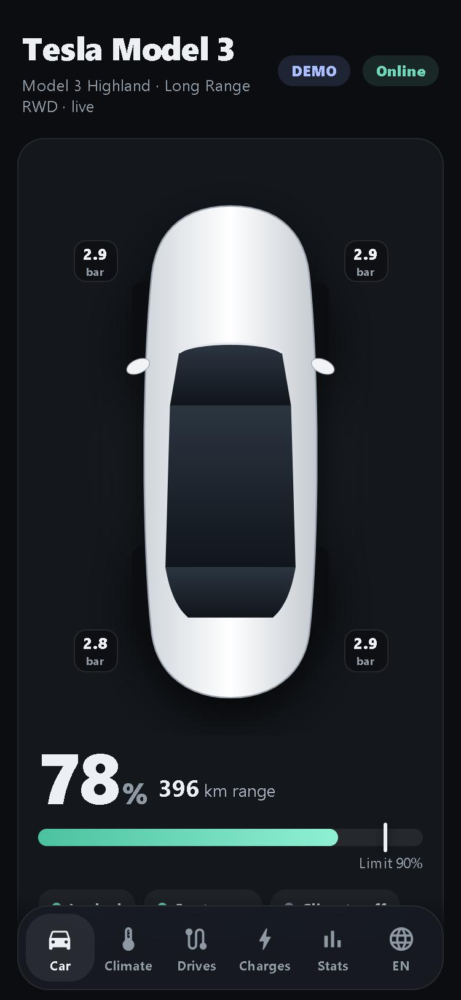
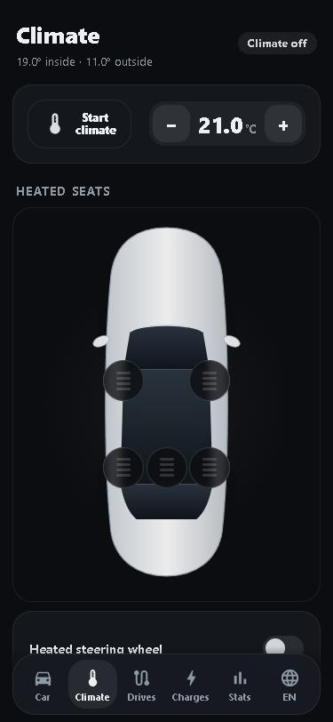
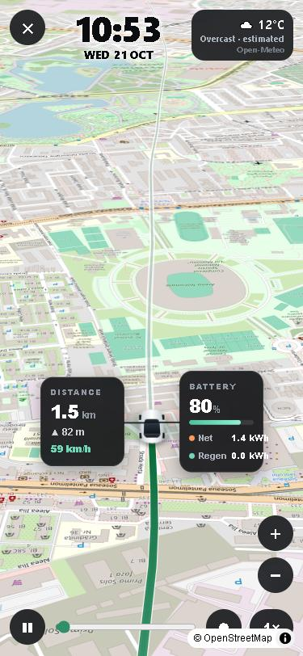
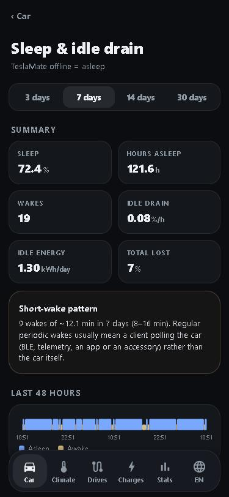

# TeslaMate UI

A mobile-first, [Tessie](https://tessie.com)-style web app (installable PWA) on top of your own [TeslaMate](https://github.com/teslamate-org/teslamate): live car state, drive and charge history, statistics, and — optionally — remote commands through Tesla's official Fleet API. Everything runs on your hardware; your data never leaves your network.

> **Not affiliated with Tesla, Inc., Tessie or TeslaMate.** "Tesla" and "Model 3/Y/S/X" are trademarks of Tesla, Inc. This project reimplements ideas visible in public documentation and its own UI; it contains no Tessie code or assets. Controlling a vehicle remotely is your responsibility — read [docs/security.md](docs/security.md) first. Provided as is, without warranty.

**Languages:** UI in Romanian and English (switch in the bottom bar; follows the browser by default). [Citește în română → README.ro.md](README.ro.md)

## Features

<p align="center">
   &nbsp;
   &nbsp;
   &nbsp;
  
</p>

| Area | What you get |
|---|---|
| **Car** | Live state via TeslaMate MQTT (battery, range, charging, locks, doors, tyre pressure if available), top-down car picture, map, last drive/charge, **sleep card** (asleep since, last sleep, sleep in the last 24 h) |
| **Controls** | Lock/unlock, climate, charging start/stop, charge port, sentry, frunk/trunk, vent/close windows, flash/honk, charge limit, **HomeLink**. Through the Fleet API, or **locally over BLE via Home Assistant** (see below) |
| **Climate page** | Target temperature, 5 heated seats on the car picture, heated steering wheel, defrost, cabin overheat protection and its threshold |
| **Charging control** | Charging current (A), scheduled charging and scheduled departure/preconditioning (current Tesla schedule model — add/remove), **energy source of each charge** (grid vs solar, estimated, via Home Assistant) |
| **Drives** | Day-grouped list; detail with speed-coloured map, charts linked to the map (touch a chart → the point on the map), **driving style** (hard braking/acceleration, regen, score); **animated 3D route replay**: tilted map following the car, clock, weather (Open-Meteo), speed-adaptive zoom, stops and charging stops, battery/net/regen/charged, click any route point to inspect it, zoom/free explore, and **export to video (MP4/WebM)** |
| **Profiler** | Live streaming of 200+ vehicle signals (Fleet Telemetry) in short sessions: profiles, grouped cells with mini charts, tiles, CSV export - [docs/profiler.md](docs/profiler.md) |
| **Sleep & idle drain** (Parked) | 48-hour sleep/awake timeline, sleep % per day, idle battery drain between drives/charges (%/h and kWh/day), detection of periodic short wakes (something polling the car) |
| **Charges** | History with curves (power, SoC, energy), cost |
| **Stats** | Distance/day, consumption, cost, range degradation, **battery health** (usable capacity from charges, charging-curve comparison, consumption vs temperature and speed), state history, software updates |
| **Notifications** | Cable connected, charging complete, door/trunk opened (while locked, or left open > 5 min), software update, battery < 20 % while parked — to a webhook (e.g. Home Assistant → phone) plus an in-app history |
| **Automations** | Open the gate on arrival at a geofence, set a charge limit when plugging in, pre-departure climate |
| **Sharing** | Roles for Cloudflare Access users: `admin`, `family` (everyday commands only), `viewer` (read-only) |
| **PWA** | Add to Home Screen on iOS/Android; works as a standalone app |

Read-only features (everything except Controls/Climate/Charging control/HomeLink/Automations) work with **just TeslaMate** — no Tesla developer account needed.

## Architecture

```
 phone / browser ──► ui (:4100) ──► TeslaMate Postgres (history)      [your TeslaMate stack]
                        │      └──► TeslaMate MQTT (live state)
                        └──► proxy (:4443, tesla-http-proxy) ──► Tesla Fleet API   [signs commands with your virtual key]
 Tesla / internet ──► ui :4101 (public listener: ONLY the Tesla public key + OAuth callback)
```

* `ui`: dependency-light Python server (`server.py`) + static single-page app (`static/`).
* `proxy`: Tesla's official [vehicle-command](https://github.com/teslamotors/vehicle-command) HTTP proxy, compiled from source at a pinned tag. It signs commands (required for modern vehicles).
* No database of its own: history comes from TeslaMate; the app only stores OAuth tokens and notification settings in `./data`.

## Requirements

* A running TeslaMate (Docker) with **MQTT enabled** for live data (history works without it) and a car already connected.
* Docker with Compose v2.24+, `openssl`, `bash` on the host that runs this app (can be the same host as TeslaMate).
* For commands only: a domain you control with HTTPS reachable from the internet, and a free Tesla developer app — see [docs/fleet-api.md](docs/fleet-api.md).

## Quick start (read-only dashboard)

```bash
git clone https://github.com/blitzu/teslamate-ui.git && cd teslamate-ui
./setup.sh                     # creates .env, keys and the internal certificate
nano .env                      # DB password, MQTT host, TESLAMATE_NETWORK (see below)
docker compose up -d --build
```

Open `http://<host>:4100`. If the page shows **DEMO** data, no car was found in TeslaMate yet (or the database is unreachable — check `docker compose logs ui`).

**Find the right values for `.env`:** the app must reach TeslaMate's database and broker by name, so it joins TeslaMate's Docker network.

```bash
docker network ls                                     # find your TeslaMate network, e.g. teslamate_default
docker inspect <teslamate-container> --format '{{range .Config.Env}}{{println .}}{{end}}' | grep -E 'DATABASE|MQTT'
```

Use those DB/MQTT values in `.env` (`DATABASE_HOST` and `MQTT_HOST` are the *service names* on that network, usually `database` and `mosquitto`).

## Settings page

Everything below can be configured **in the app** (⚙ Settings tab, administrator only): command PIN, Tesla Fleet API credentials, Home Assistant link, notification webhook, internet access/roles, currency and links. Values are saved in `./data/config.json` (mode 600) and apply immediately; secret fields are never shown again. The scripts in `scripts/` and the `.env.*` files remain available and act as defaults (the Settings page overrides them). The very first PIN can only be set from your local network.

## Enable commands (Fleet API)

Controls need a Tesla developer app, a public HTTPS domain that serves your public key, and a virtual key installed in the car. Step by step in **[docs/fleet-api.md](docs/fleet-api.md)**.

## Access from the internet

Keep the app on your LAN unless you protect it. Options (Cloudflare Access recommended), PIN, passwords and what port 4101 exposes: **[docs/security.md](docs/security.md)**.

## Home Assistant (optional)

Local Bluetooth commands through an ESP32, energy source per charge: **[docs/home-assistant.md](docs/home-assistant.md)**.

## Notifications

Set `NOTIFY_WEBHOOK` — see **[docs/notifications.md](docs/notifications.md)** (includes a Home Assistant automation).

## Customising

* **Car picture:** drop a top-down transparent PNG of your car at `./data/car.png` (a generic drawing is used otherwise; the seat buttons on the Climate page are positioned for a typical sedan top view).
* **Currency:** `CURRENCY` in `.env` (cost comes from the prices you set in TeslaMate).
* **Public demo with fictional data:** `docker compose --profile demo up -d demo` (port 4102, no database, no keys, commands disabled).

## Third-party services used by the browser

Map tiles from OpenStreetMap, MapLibre GL JS and Leaflet from cdnjs, weather from Open-Meteo (route replay sends coordinates rounded to 0.1° from the browser). Respect the [OSM tile usage policy](https://operations.osmfoundation.org/policies/tiles/) — fine for personal use; use your own tile provider for heavy traffic.

## More

* [docs/fleet-api.md](docs/fleet-api.md) — Tesla developer app, domain, key, authorisation
* [docs/security.md](docs/security.md) — internet exposure, PIN, passwords, Cloudflare Access
* [docs/home-assistant.md](docs/home-assistant.md) — BLE commands, energy source, automations
* [docs/profiler.md](docs/profiler.md) - live telemetry profiler
* [docs/notifications.md](docs/notifications.md) — webhook and Home Assistant example
* [docs/troubleshooting.md](docs/troubleshooting.md) — common errors
* [docs/development.md](docs/development.md) — structure, local demo, API, contributing

## License

MIT — see [LICENSE](LICENSE).
